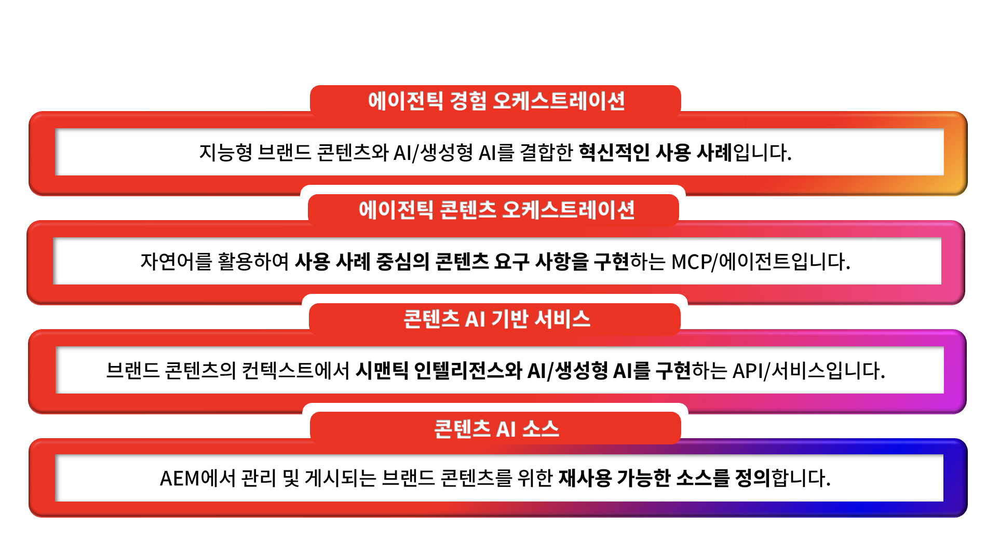

# AEM 콘텐츠 AI - 소개

## 지능형 콘텐츠, AI 지원 설계 {#ai-ready}

고객은 이제 웹 사이트를 방문하기 전에 AI를 통해 브랜드를 먼저 접하기 시작했습니다.채팅 어시스턴트, AI 개요, 에이전트, 대화형 검색, AI 컨시어지는 모두 브랜드 콘텐츠를 검색하고 요약하며 브랜드를 대신해 전달합니다.이들이 내놓는 답변의 정확성, 최신성, 브랜드 부합도는 접근할 수 있는 콘텐츠의 수준을 넘을 수 없습니다.
AEM Content AI는 바로 이러한 변화에 대응하기 위해 개발되었습니다.브랜드 콘텐츠를 AI 경험의 기반이 되는 기준 정보로 삼습니다. 또한 AEM 고객이 작성 환경에서 이 기준 정보를 더 빠르게 만들고, 게시 환경에서 소비자 대상 AI 기반 경험에 원활하게 제공할 수 있도록 도구를 제공합니다.

**작성자 측**&#x200B;에서 AEM 콘텐츠 AI는 승인된 브랜드 소스를 기반으로 생성을 수행합니다. AI 지원 작성, 기존 페이지 콘텐츠, 조각 및 에셋에 대한 자연어 검색, 브랜드 인식 세대를 통해 팀은 AEM을 종료하거나 이미 승인된 내용에서 벗어나지 않고도 새로운 대상자, 지역 및 채널에 대한 베리에이션을 만들 수 있습니다.

**게시 측**&#x200B;에서는 AI가 사용할 수 있도록 동일한 콘텐츠가 구조화되고 관리되며 주소 지정이 가능합니다. 조각, 메타데이터, 분류 및 승인된 소스는 검색 시스템, 에이전트 및 대화 인터페이스가 안심하고 사용할 수 있는 형태로 노출됩니다. 따라서 AI가 브랜드를 대변할 때는 브랜드의 진실을 대변하는 것입니다.

### AEM 고객에게 의미하는 바 {#what-it-means}

승인된 콘텐츠는 AI의 환각 현상으로부터 브랜드를 보호합니다.거버넌스가 적용된 AEM 콘텐츠를 기반으로 하는 AI 답변은 기본적으로 정확성과 최신성, 브랜드 일관성을 유지합니다.
콘텐츠 작성은 AI 시대의 수요에 발맞춥니다.팀은 작성 환경에서 처음부터 새로 시작하는 대신 승인된 소스를 활용하여 더 다양한 대상자와 상황에 맞는 카피와 이미지를 생성합니다.
탐색은 사람과 기계가 실제로 질문하는 방식에 맞춰 이루어집니다.에셋, 조각, 페이지, 양식 전반을 아우르는 자연어 및 의도 기반 검색은 기존 콘텐츠를 재사용 가능한 자원으로 바꿉니다.
개인화는 복제가 아닌 재사용을 통해 확장됩니다.거버넌스가 적용된 구성 요소는 변형으로 재조합되며, 추적되지 않는 사본으로 늘어나지 않습니다.
이제 게시 채널에는 AI 표면도 포함됩니다.사람과 에이전트는 물론 AI를 매개로 하는 경험에서도 활용할 수 있는 형태로 콘텐츠가 제공됩니다. 각각을 위한 별도 파이프라인은 필요하지 않습니다.

**더 큰 장점: 기존의 신뢰할 수 있는 브랜드 콘텐츠가 그 어느 때보다 더 큰 가치를 갖게 됩니다. AEM에 이미 존재하는 승인된 모든 조각, 에셋 및 페이지는 AI 기반 환경이 의존하는 기본 진리가 됩니다. 그리고 AEM 콘텐츠 AI는 이러한 라이브러리를 재사용 가능하고 검색 가능하며 다음에 나올 기능을 강화할 수 있게 만드는 요소입니다.**

## AEM 콘텐츠 AI 한눈에 보기 {#at-a-glance}

AEM 콘텐츠 AI는 토대에 있는 신뢰할 수 있는 콘텐츠부터 최상위에서 제공하는 에이전트 환경에 이르기까지, 각 레이어를 단계별로 구축하는 4개 레이어 스택으로 구조화됩니다.

*스택을 토대가 되는 신뢰할 수 있는 콘텐츠부터 최상단의 에이전트 환경까지 아래에서 위로 읽으십시오.*

1. 콘텐츠 AI 소스
콘텐츠 소스는 신뢰할 수 있는 콘텐츠 본문에 연결하는 AEM 콘텐츠 AI의 관리형 엔티티입니다. 콘텐츠 소스는 에셋, 콘텐츠 조각, 페이지, 양식, 메타데이터, 분류 등과 같은 AEM에서 관리하는 콘텐츠 유형과 타사 웹 사이트, 기술 자료 또는 설명서 포털과 같은 비 AEM 소스를 참조할 수 있습니다. 각 콘텐츠 소스는 자동으로 벡터화되고 의미적으로 보강되어 검색, 그라운딩 및 대화형 AI 경험을 지원합니다. 콘텐츠 소스를 한 번 정의하면 자동 새로 고침 및 업데이트 기능이 기본 제공되는 콘텐츠 AI API에서 재사용할 수 있습니다.

1. 콘텐츠 AI 기본 서비스
브랜드 콘텐츠 컨텍스트에서 시맨틱 인텔리전스 및 생성형 AI를 사용 가능하게 하는 API 및 서비스입니다. 콘텐츠 AI 소스 위에서 작동하는 이러한 서비스는 검색, 생성, 브랜드 인식 베리에이션, 최적화 등 모두 고객의 승인된 콘텐츠에 기반을 둔 기능을 제공합니다.

1. 에이전틱 콘텐츠 오케스트레이션
사용 사례 중심의 콘텐츠 요구 사항을 자연어를 통해 조정된 작업으로 만드는 MCP 및 에이전트. 이 레이어를 이용하면 작성자와 다른 에이전트가 필요한 내용을 일반 언어로 설명하고 적절한 기본 서비스를 오케스트레이션하여 이를 수행할 수 있습니다.

1. 에이전틱 경험 오케스트레이션
인텔리전트 브랜드 콘텐츠가 규모에 맞는 AI를 만날 때 나타나는 혁신적인 활용 사례입니다. AEM 솔루션 자체는 이러한 기본 서비스를 기반으로 구축되며, 고객은 동일한 API를 직접 사용하여 자체 콘텐츠 위에 자체 에이전틱 경험을 구축할 수 있습니다. AI 기반 콘텐츠 공급망에서 대화형 사용자 여정에 이르기까지, 이 레이어에서는 관리되는 콘텐츠가 경쟁 우위가 됩니다.

이러한 레이어는 디자인에 의해 연결됩니다. 모든 AI 서비스는 콘텐츠 기반에서 나오며, 생성된 모든 것은 동일한 관리 시스템으로 다시 돌아갑니다. 따라서 작성자측 생성과 게시측 전달은 하나의 사실 소스를 공유합니다.

## AEM 콘텐츠 AI 활용 사례 {#action}

효과적인 콘텐츠 AI 통합에는 다음 두 가지 작업이 포함됩니다.

### &#x200B;1. AEM 환경에 콘텐츠 AI 활성화 {#enable}

**전제 조건:** 콘텐츠 AI 사용을 시작하기 전에 AEM as a Cloud Service 환경에 맞는 API 자격 증명이 필요합니다. [Adobe Developer Console 프로젝트 설정](setup-adc-project.md)을 참조하십시오.

### &#x200B;2. 콘텐츠 AI 소스 제어 {#control}

콘텐츠 AI 소스를 설정 및 관리하여 AI 기반 환경을 사용하도록 설정합니다. 자세한 내용은 [콘텐츠 소스 제어](contentsources.md)를 참조하십시오.

## 콘텐츠 AI API 알아보기  {#apis}

AEM 콘텐츠 AI의 다양한 기능을 살펴보십시오. API는 플랫폼의 모든 잠재력을 보여줍니다. [콘텐츠 AI API](https://developer.adobe.com/experience-cloud/experience-manager-apis/api/experimental/contentai/)를 참조하십시오.
